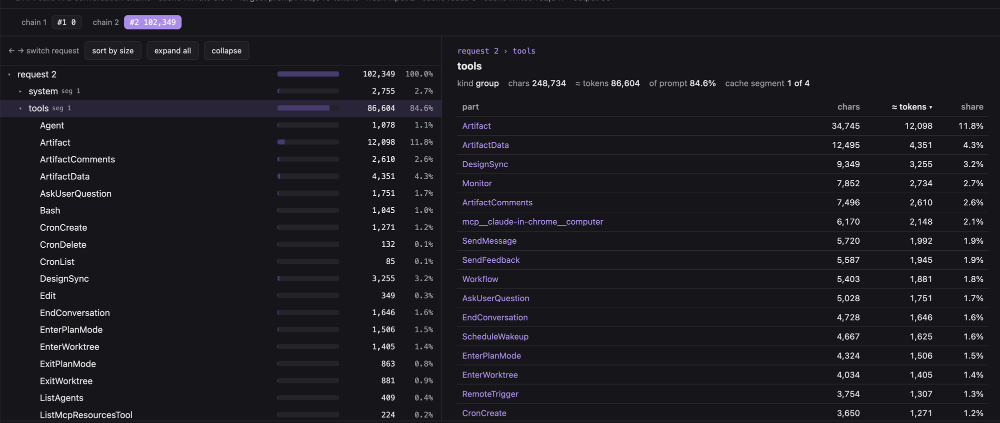

# Claude Your Synth — Getting Started

A minimal C++20 starter project for the workshop by million-tokens.com. It builds a JUCE console
application and prints the JUCE version. Use it as the base for the synth you write during the
workshop.

---

## Architecture

```
CMakeLists.txt              # CMake project, fetches JUCE 8.0.4, defines the MiniSynth target
build.sh                    # configures, builds and runs the executable
test.sh                     # builds and runs the tests
workshop.sh                 # moves the checkout between the lesson tags, sets up the Claude profile
capture.sh                  # records what a session sends to the model, renders it as HTML
capture/                    # the proxy, the viewer and the renderers behind capture.sh
claude-config/statusline.py # the status line that profile setup installs
src/Main.cpp                # entry point
tests/                      # Catch2 v3 tests, the MiniSynthTests target
docs/                       # code guidelines for Claude Code
CLAUDE.md                   # top-level brief for Claude Code
```

- **Build system:** CMake 3.22 or later.
- **Dependencies:** CMake `FetchContent` downloads JUCE 8.0.4 and Catch2 v3.7.1 at configure time.
  You do not install them yourself. The first configure step takes some minutes.
- **Targets:** `MiniSynth`, a console application, and `MiniSynthTests`, the test binary. Both
  link `juce::juce_core`.
- **Standard:** C++20. CMake also writes `compile_commands.json` for clang-tidy and the editor.

---

## Build, run and test

```bash
./build.sh   # configure a Release build in build/, compile MiniSynth, run it
./test.sh    # build MiniSynthTests in the same build/ directory, run the tests with ctest
```

`build.sh` does not compile the tests. To get the Catch2 options, run
`./build/tests/MiniSynthTests --help`. Add new test files to `tests/`, then list them in the
`add_executable` command in `tests/CMakeLists.txt`.

---

## Workshop navigation

`workshop.sh` moves your checkout between the lessons. Each lesson is an annotated git tag in the
upstream repository, for example `lesson-03-filter`.

```bash
./workshop.sh list                     # show the lesson tags
./workshop.sh reset lesson-03-filter   # move your branch to the state of lesson 03
./workshop.sh reset main               # go back to the starting point
./workshop.sh reset                    # choose the lesson from a menu
./workshop.sh pull                     # get the latest fixes from upstream main
```

Work on your own branch, for example `git switch -c my-work`. The script refuses to change `main`,
because `main` keeps your reference copy of the starter.

`reset` discards local commits and uncommitted changes on the current branch. The script prints a
warning and asks for confirmation first.

The script needs SSH access to GitHub. After the first run, the lesson tags stay in your
repository, so `git switch --detach lesson-03-filter` also works. `./workshop.sh -h` lists the
environment variables that change the upstream and the tag prefix.

### For the workshop author: how to make a lesson

The workshop needs the tags and nothing else. Commit on a detached HEAD, then push the tag alone:

```bash
git switch --detach main
git commit -am "Add a sine oscillator"
git tag -a lesson-01-oscillator -m "Add a sine oscillator"
git push origin lesson-01-oscillator
```

- Start every tag name with `lesson-`, then a zero-padded number. The menu sorts by tag name.
- Use annotated tags. The menu shows the tag message as the lesson title.
- To move a tag, run `git tag -f -a ...`, then `git push --force origin <tag>`. The next `reset`
  of a student gets the new position.
- To remove a tag, run `git tag -d <tag>`, then `git push origin --delete <tag>`.

---

## Start Claude Code with the workshop profile

The workshop uses a separate Claude Code configuration. Your own settings, skills, hooks and
session history stay in `~/.claude`. The workshop does not read them and does not change them.

```bash
./workshop.sh profile setup    # make the workshop configuration (run once)
./workshop.sh claude           # start a recorded session on that configuration
./workshop.sh profile status   # show the configuration and the recorder state
./workshop.sh profile remove   # delete the configuration
```

`setup` makes `~/claude-synth-workshop/claude-config` with a `settings.json`. The settings switch
off the claude.ai connectors and the Artifact tool, because these add much text to every prompt.
The settings also install a status line under the input box:

```
Claude-Your-Synth-Getting-Started (my-synth) in 12.4k out 1.8k ctx 14.2k $0.42
```

`ctx` is the size of the context now. It changes to red when it is more than 200k. The cost is for
the whole session. The status line needs `python3`. You can run `setup` again at any time. It does
not change a configuration that already exists.

`./workshop.sh claude` is `claude` with `CLAUDE_CONFIG_DIR` set to the workshop directory. Any
argument after `claude` goes to Claude Code. The first session starts logged out. Run
`claude auth login` once inside the session.

To go back to your own setup, start `claude` as usual. The script deletes nothing from `~/.claude`.
`./workshop.sh -h` lists the environment variables, for example `WORKSHOP_CAPTURE=0` to start a
session without a recording.

---

## See what the model actually received

The model is stateless. It keeps nothing between calls, so every request sends the whole context
again: the system prompt, the schema of every tool, and the conversation. Your `CLAUDE.md`, your
settings and your context hygiene all show in this payload. The transcript in
`~/.claude/projects/` does not show the system prompt, the tool schemas or the cache breakpoints.
Only the requests on the network contain them.

`./workshop.sh claude` records each request through a local proxy. At the first API call, the
recording opens in your browser. The page then follows the session. When you quit, the script
saves the pages into `captures/<timestamp>/`. If the recorder cannot start, the script tells you
and starts the session without it.

To compare, run one session with `./workshop.sh claude` and one with `./workshop.sh claude-own`.
`claude-own` records a session on your own configuration. The difference is what your own
settings, skills and MCP servers add to every request. `./capture.sh list` shows the recordings.



The recording has two pages. `index.html` shows the tokens of each call and what changed since
the previous call. `context_profiler.html`, above, divides one request into its parts. The tree on
the left shows the estimated tokens of each part. The table on the right sorts the parts by tokens.
In this example, the tool schemas are 84.6% of the prompt, and the Artifact tool alone is 12k
tokens. Use the arrow keys to move from one request to the next one.

To record a session that you start yourself, use three terminals:

```bash
./capture.sh start                                # terminal 1: the recorder
./capture.sh view                                 # terminal 2: the page
export ANTHROPIC_BASE_URL=http://127.0.0.1:8788   # terminal 3
CLAUDE_CONFIG_DIR=~/claude-synth-workshop/claude-config claude   # terminal 3
```

`./capture.sh -h` lists the other commands and options. Inside a session, the `/capture` command
renders the current recording. The recording does not contain credentials. It contains your
prompts, your files and the answers, so keep it private. `captures/` stays out of git.

---

## `CLAUDE.md` — instructions for the AI assistant

Claude Code reads `CLAUDE.md` at the start of every session. The file stays short. It points to
this README and to the guideline files in `docs/`. Claude reads those files only when the task
needs them:

```
CLAUDE.md
├── README.md                      # project, architecture and build steps
└── docs/
    ├── common-guidelines-code.md  # applies to all code
    ├── cpp-guidelines.md          # for C++ files
    └── bash-guidelines.md         # for shell scripts
```

---

## Style toolchain

- `.editorconfig` — 4 spaces, LF line endings, no trailing whitespace, a final newline.
- `.clang-format` — LLVM style, 4-space indentation, 120-character lines. Run
  `clang-format -i <file>`.
- `.clang-tidy` — the `bugprone`, `cppcoreguidelines`, `modernize`, `performance` and
  `readability` checks. The header checks apply only to the headers under `src/`.
- `.claude/settings.json` — a hook runs `clang-format` on each C++ file that Claude edits. Claude
  runs `cmake`, `make` and some other commands without a permission prompt.
